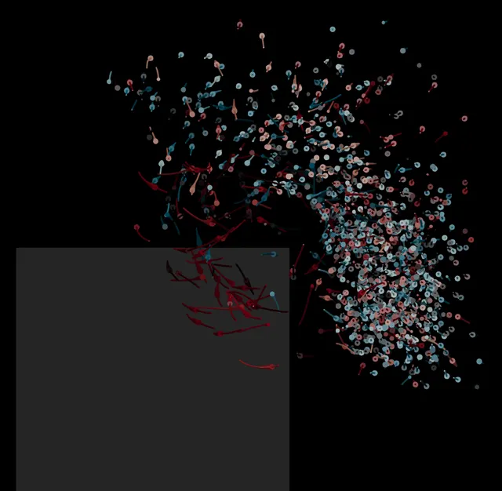

# Coherent-structure colouring

<p align="center">
  <a href="https://doi.org/10.1007/s00348-021-03135-5"></a>
  <a href="https://www.python.org/"></a>
  <a href="https://github.com/EngFlavioMartins/coherent-structure-colouring/blob/HEAD/LICENSE"></a>
  <a href="https://engflaviomartins.github.io/#work-csc"></a>
</p>

**Find vortices in sparse particle tracks.**

<p align="center"></p>

Coherent-structure colouring (CSC) gives each particle track a value from how its distance to every other track changes in time: tracks that move together get similar values. This Python version also picks the eigenvector that separates the vortex (`select_mode`). Ahmed-body tracks from the paper's experiment are included.

## Run it

```bash
git clone https://github.com/EngFlavioMartins/coherent-structure-colouring.git
cd coherent-structure-colouring
python run.py
```

`run.py` colours the bundled Ahmed-body tracks and prints, for each leading mode, how it relates to speed and to vorticity, marking the one it selects. The first time, it installs what it needs into a private `.venv` folder (a minute or so); after that it starts at once. All you need is Python 3.10 or newer.

<details>
<summary>Prefer conda?</summary>

```bash
conda env create -f environment.yml
conda activate coherent-structure-colouring
python examples/ahmed_body.py
```

</details>

**Next:** To use your own tracks, see `tracks_from_table` and `leading_modes` in [`src/coherent_structure_colouring/`](src/coherent_structure_colouring/). The 2020 MATLAB code is not available, and this version does not reproduce the CSC values stored with the data.

## Figure and animation

<p align="center"></p>

The same wake with sparse and dense seeding, seen along the stream: tracks in the trailing vortex are red, the rest teal.

```bash
sh scripts/render/make_figure.sh          # the figure
python scripts/render/make_animation.py   # the animation at the top
```

Both need [ParaView](https://www.paraview.org/download/); the figure also needs LaTeX.

## Cite

This code implements the method of the paper below. If you use it, please cite:

```bibtex
@article{martins2021csc,
  author  = {Martins, Flavio A. C. and Sciacchitano, A. and Rival, D. E.},
  title   = {Detection of Vortical Structures in Sparse Lagrangian Data Using Coherent-Structure Colouring},
  journal = {Experiments in Fluids},
  volume  = {62},
  number  = {4},
  pages   = {69},
  year    = {2021},
  doi     = {10.1007/s00348-021-03135-5}
}
```

GitHub's **Cite this repository** button (from [CITATION.cff](CITATION.cff)) gives the same reference in other formats.

## Licence

[Apache 2.0](LICENSE): you are free to use, change and share this code, also commercially. If you pass it on, keep the [NOTICE](NOTICE) file with it; it says where the code comes from and how to cite it.
