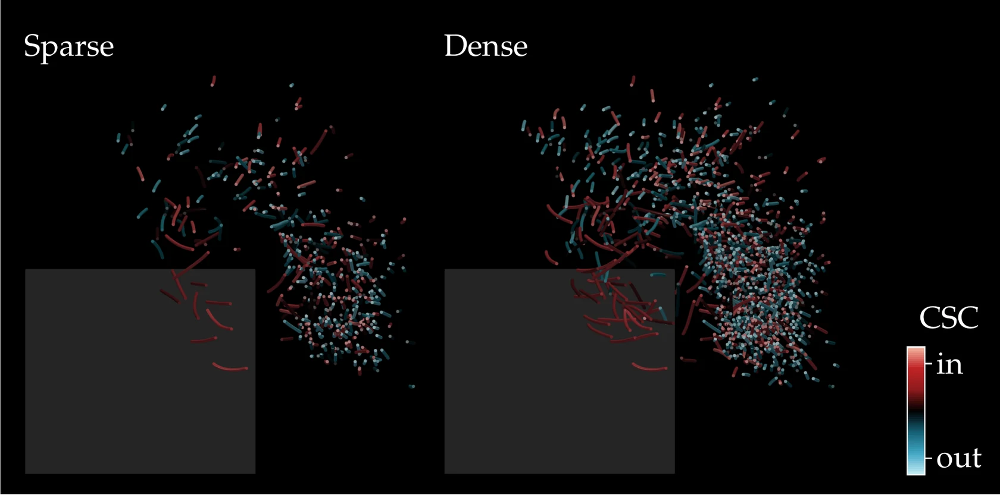

# Coherent-structure colouring

**Find vortices in sparse particle tracks.**

<p align="center"></p>

Coherent-structure colouring (CSC) gives each particle track a value from how its distance to every other track changes in time; tracks that move together get similar values. This Python version also picks the eigenvector that separates the vortex (`select_mode`), because on sparse measured tracks the classical leading eigenvector mostly separates fast from slow fluid. The repository includes Ahmed-body tracks from the paper's experiment.

## Get started

```bash
git clone https://github.com/EngFlavioMartins/coherent-structure-colouring.git
cd coherent-structure-colouring
pip install -r requirements.txt
python examples/ahmed_body.py
```

This prints, for each leading mode, how it relates to speed and to vorticity, and marks the one selected. The 2020 MATLAB code is not available, and this version does not reproduce the CSC values stored with the data.

## Make the figure above

```bash
sh scripts/render/make_figure.sh
```

You need [ParaView](https://www.paraview.org/download/) (for `pvpython`), a LaTeX installation, and `pip install pyvista pillow`.

## Cite

This code implements the method of the paper below. If you use it, please cite:

```bibtex
@article{martins2021csc,
  author  = {Martins, Flavio A. C. and Sciacchitano, A. and Rival, D. E.},
  title   = {Detection of Vortical Structures in Sparse Lagrangian Data Using Coherent-Structure Colouring},
  journal = {Experiments in Fluids},
  volume  = {62},
  number  = {4},
  pages   = {69},
  year    = {2021},
  doi     = {10.1007/s00348-021-03135-5}
}
```

GitHub's **Cite this repository** button (from [CITATION.cff](CITATION.cff)) gives the same reference in other formats.

## Licence

MIT; see [LICENSE](LICENSE).
